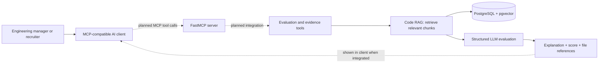

<div align="center">

# Recruise

### Technical hiring, grounded in the code candidates actually write.

An evidence-first technical vetting platform that analyzes a candidate’s GitHub repository against a role-specific engineering rubric and returns scored findings with source-file references.


</div>

---

## A clearer signal for technical hiring

Resumes and interviews are useful, but they can leave a gap between what a role asks for and what a candidate has demonstrated in real code. AI Recruiter is designed to help teams close that gap with a consistent, reviewable assessment of repository evidence.

For each application, the evaluation engine:

1. Turns the job description into five specific, code-verifiable criteria.
2. Finds relevant code in the candidate’s supported-language repositories.
3. Scores each criterion using retrieved code as evidence.
4. Produces a 0–100 summary score and a criterion-by-criterion report, including explanations and referenced file paths.

The result is a **decision-support signal for human reviewers**—not an automated hiring decision.

## What teams can do

| Capability | What it means for your team |
| --- | --- |
| **Role-specific evaluation** | Builds a technical rubric from the job description instead of applying one generic checklist to every role. |
| **Code-aware repository analysis** | Extracts meaningful functions, classes, methods, interfaces, and top-level logic rather than treating source files as undifferentiated text. |
| **Evidence-linked findings** | Each criterion receives a score, a concise technical explanation, and the file paths used as evidence. |
| **Consistent scoring** | Applies the same five-criterion, 1–5 scale for each completed evaluation and normalizes the result to 0–100. |
| **Application-aware retrieval** | Restricts code search to the candidate, job, and company associated with the application being evaluated. |
| **Conversational review in your AI workspace** | Planned: connect an MCP-compatible AI client to ask natural-language questions about an evaluation and explore its retrieved code evidence without leaving the reviewer’s workflow. |
| **Background processing** | Runs repository ingestion and candidate evaluation as queued jobs, separate from the API request process. |
| **Resilient AI-provider requests** | Uses shared Redis-backed request/token throttling and bounded retries with backoff for transient provider and Git errors. |
| **Persistent evaluation records** | Stores job rubrics, application scores and reports, repository metadata, and code evidence for later review. |

## How an evaluation works

### 1. Define the role

A job description supplies the role context. The evaluation engine extracts and saves a five-item technical rubric on the job record, then reuses that rubric for later applications to the same job.

### 2. Index the candidate’s code

The ingestion worker shallow-clones the configured repository into a temporary directory. It parses supported source files into semantic chunks, creates vector embeddings, and stores the resulting code evidence for retrieval. The temporary clone is removed when ingestion leaves its temporary-directory context.

### 3. Retrieve relevant evidence

For each rubric criterion, the evaluator searches for the most relevant candidate code chunks using vector similarity. The database query also checks the application/job/company relationships so unrelated candidate code is not returned for that evaluation.

### 4. Review the scored report

Each criterion is scored from 1 to 5. The overall score is the sum of the criterion scores scaled to a percentage. The report preserves the criterion, score, explanation, and referenced files so a reviewer can inspect the basis for the result.

**Example report shape**

| Criterion | Score | Evidence summary | References |
| --- | ---: | --- | --- |
| Implements resilient service-to-service communication | 4 / 5 | Retrieved code demonstrates retries and explicit handling of request failures. | `src/client.py`, `src/retry.ts` |
| Uses clear modular boundaries | 3 / 5 | Some responsibilities are separated into modules; other logic remains coupled. | `app/main.py` |

*Illustrative example only; actual criteria and findings depend on the job description and repository evidence.*

## A more natural way to review: MCP + code RAG

The product vision goes beyond generating a score. It brings **retrieval-augmented generation (RAG)** and the **Model Context Protocol (MCP)** together to help engineering managers and recruiters move from a job requirement to the code that supports—or does not support—a finding.

RAG supplies the grounding: the system searches semantically chunked repository code for evidence relevant to a rubric criterion, then asks the evaluator to assess only that retrieved context. MCP is the planned interaction layer: a FastMCP server will expose focused evaluation and evidence-retrieval tools to MCP-compatible AI clients, such as a recruiter’s approved desktop assistant. The client can then make review feel conversational rather than requiring reviewers to navigate raw vector results or database records.

In the intended experience, a reviewer could ask questions such as:

- “What evidence supports this score for the caching requirement?”
- “Which files should I inspect to understand the candidate’s API error handling?”
- “Summarize the strongest code evidence for this application against the rubric.”

The assistant’s value comes from the combination: **MCP makes the workflow accessible in the reviewer’s AI client; RAG keeps answers tied to relevant repository evidence.** File references make it easier to inspect the underlying code and challenge an interpretation. This is designed to make technical review faster and more transparent—not to hide the evidence behind a score or automate a hiring decision.



> **Availability:** Repository ingestion, vector retrieval, rubric-based evaluation, and report persistence are implemented in the current codebase. The FastMCP server, MCP tools, and interactive AI-client experience are **planned and not currently available**. The current API does not yet expose the record-management or evaluation-request endpoints needed for a complete client workflow.

### Why this architecture benefits reviewers

- **Code-aware context:** Tree-sitter extracts whole functions, classes, and other structural units, helping preserve the logic an evaluator needs instead of slicing code at arbitrary character limits.
- **Evidence and business context together:** PostgreSQL stores hiring records alongside pgvector embeddings. Retrieval uses relational application, job, and company filters as well as vector similarity, keeping searches scoped to the evaluation context.
- **A responsive product path:** Celery and Redis separate longer repository-ingestion and evaluation work from the web/API process. This gives the product a path to handle tasks without making a reviewer wait on a single request.
- **A reviewer-first interaction model:** MCP is intended to let a compatible client invoke deliberate product tools, while RAG supplies relevant code context for the response. Access controls and authorization still need to be implemented and reviewed before this can be used with real recruiting data.

## Supported code today

Repository parsing currently covers:

- **Python** (`.py`)
- **JavaScript** (`.js`, `.jsx`)
- **TypeScript** (`.ts`, `.tsx`)

The parser extracts language-specific constructs such as functions, classes, methods, and interfaces, and retains top-level module statements as a separate chunk. It skips common generated or dependency directories, including `.git`, `node_modules`, virtual environments, `dist`, `build`, and `.next`. Individual source files larger than 100 KB are skipped.

Other languages and repository contents are not evaluated by the current parser. A repository with no supported, extractable code can be ingested with zero code chunks; evaluation then has no repository evidence to assess.

## Built for review, not blind automation

AI Recruiter is intended to help technical teams focus review time and make assessments more consistent. It does not establish that a candidate authored every line of a repository, verify employment history, or replace interviews, reference checks, accessibility accommodations, or human judgment. Repository evidence can be incomplete or unrepresentative, so reviewers should validate findings in context and avoid using a score as the sole basis for a hiring decision.

The evaluation report is grounded in retrieved source chunks, but generated explanations can still be mistaken or incomplete. Review the cited files before acting on a result.

## Service availability

The current codebase contains the evaluation and repository-ingestion engine, database models, worker queues, and a small FastAPI service surface. The API currently exposes:

- `GET /` — service-running message.
- `GET /health` — checks database connectivity and reports service/database status.
- `/docs` — interactive API documentation generated by FastAPI.

Candidate, company, job, repository, and application records are represented in the data model, and ingestion/evaluation are implemented as background tasks. **Public API endpoints for creating or managing those records, submitting repositories, and requesting evaluations are not yet implemented.** The current release is therefore an early-access backend foundation, not a turnkey recruiting dashboard or self-service client application.

## Service components

- **API:** FastAPI service for health checks and the current API surface.
- **Evaluation worker:** Celery tasks for repository ingestion and application evaluation.
- **Queue and coordination:** Redis broker/backend, plus shared provider rate-limit buckets.
- **Storage and vector search:** PostgreSQL 16 with the `pgvector` extension and cosine-similarity indexes.
- **Code understanding:** Tree-sitter parsers for the supported languages.
- **Embeddings:** Jina AI `jina-embeddings-v3` using separate passage and query modes.
- **Rubric extraction and scoring:** Groq-hosted structured-output model, configurable with `GROQ_MODEL`.

## Run the current service locally

This section is for teams evaluating the early-access service. It is not a client-facing signup flow.

### Requirements

- Docker Engine with the Compose plugin
- Python environment with the application’s dependencies installed
- Git
- Groq and Jina API credentials

> **Dependency note:** This repository currently has no `requirements.txt` or Python project manifest. Install the dependencies used by the application in your chosen Python environment before starting the API and Celery worker.

### 1. Start PostgreSQL and Redis

From the repository root, start the included infrastructure:

```bash
docker compose up -d
```

The Compose file exposes PostgreSQL on port `5432` and Redis on port `6379`. Its local database credentials are development defaults; do not use them for a shared or production deployment.

### 2. Configure provider credentials

Set these variables in the environment used by both the API and worker:

| Variable | Purpose |
| --- | --- |
| `GROQ_API_KEY` | Required for rubric extraction and criterion scoring. |
| `JINA_API_KEY` | Required for code and query embeddings. |
| `GROQ_MODEL` | Optional model override; defaults to `openai/gpt-oss-120b`. |

The application loads `.env` values for the AI components. Do not commit secrets. The database and Celery connection strings are currently configured in application code for local services, so update those settings before using a different host or deploying.

### 3. Start the API and worker

In separate terminals, from the repository root:

```bash
uvicorn app.main:app --reload
```

```bash
celery -A app.celery_app:celery_app worker --loglevel=info -Q queue_ingestion,queue_evaluation
```

Open `http://localhost:8000/docs` to inspect the current API routes, or `http://localhost:8000/health` to check database connectivity. The worker listens on the two dedicated queues; integration code must enqueue the corresponding tasks after creating the required database records.

### 4. Stop local infrastructure

```bash
docker compose down
```

To also remove the local database and Redis data volumes, use `docker compose down -v`. This permanently deletes their persisted local data.

## Data and operational notes

- Repository ingestion currently uses a shallow Git clone and has no configured private-repository credential flow. Use repositories accessible to the worker without interactive authentication.
- Source chunks and their 1024-dimensional embeddings are stored in PostgreSQL. Deleting the temporary clone does **not** delete indexed code from the database.
- Job descriptions and evaluation reports are stored in the database. Treat these as sensitive recruiting data and apply appropriate access, retention, and deletion policies before production use.
- The application includes application-aware query filters, but this is not a substitute for a complete production security review, authentication, authorization, tenant-access testing, and secure secret management.
- Provider calls transmit job-description text, rubric criteria, and/or extracted code chunks to the configured AI services. Review provider terms and applicable privacy requirements before sending real candidate data.

## Product direction

The current foundation delivers the core assessment loop: ingest supported source code, retrieve relevant evidence, evaluate it against a role-specific rubric, and persist a reviewable report. The next product milestones are to complete the client workflow with authenticated record-management and submission endpoints, add and validate FastMCP tools for interactive evidence exploration, and integrate those tools into recruiter and engineering-manager experiences. Production readiness also requires access controls, secure secret management, tenant-isolation testing, and operational policies for data retention and review.

### What’s next

The roadmap is iterative; these are planned capabilities, not promises of a release date:

1. **Harden the data foundation:** introduce Alembic-managed schema migrations and deployment-ready configuration for PostgreSQL, pgvector, and Redis.
2. **Complete the client workflow:** add authenticated REST endpoints for managing hiring records, submitting repositories, and requesting evaluations.
3. **Bring evidence into the AI client:** expose carefully scoped FastMCP tools so reviewers can explore an evaluation and its code evidence through a compatible MCP client.
4. **Deliver a recruiter experience:** build a dedicated interface, planned with React, Vite, and Tailwind, that works with the backend and makes reports and referenced code easy to review.
5. **Prepare for responsible production use:** implement and test authentication, authorization, tenant isolation, secret handling, and candidate-data retention policies.

---

<div align="center">

**More signal from real engineering work. More context for every score.**

</div>
